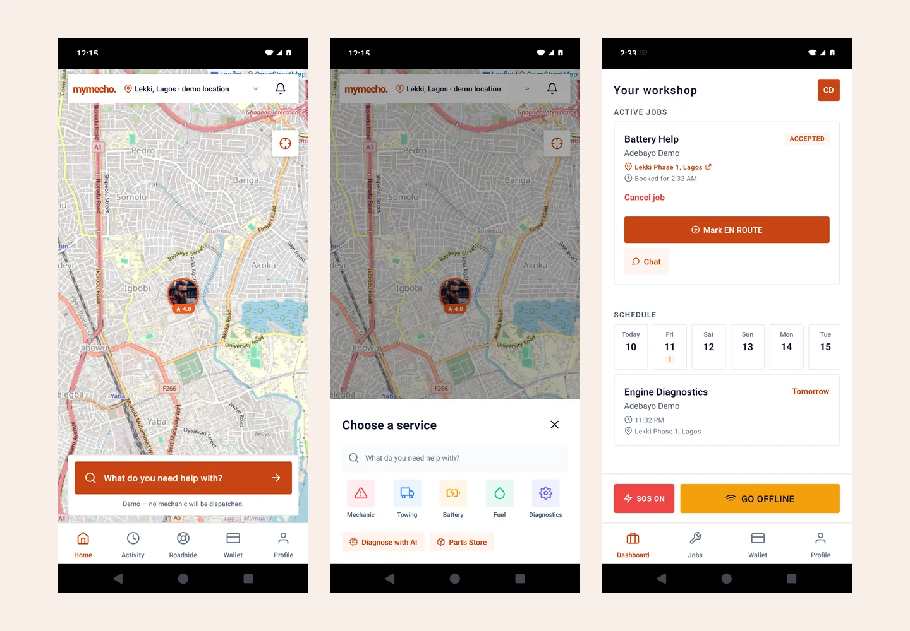

# MyMecho

**A driver-to-mechanic service journey, built around the realities of roadside help in Nigeria.**

_Actual September 10, 2026 Android demo screens arranged together. Participants, bookings and amounts are fictional; no mechanic is dispatched. Map tiles retain their visible attribution._

## Problem and approach

Finding help is only the beginning of a repair. The demo connects service selection, offers, booking chat, job progress and cancellation into customer and mechanic journeys. Mechanics can change availability and review roadside scenarios; drivers can understand the chosen service and follow its status.

## Architecture

React Native, Expo and TypeScript provide the mobile app. The showcased offline demo uses device-local transport and sample data. A separate Express/Socket.IO backend, connected mobile build and staff workspace are under development. Those are not interchangeable with the demo pictured above.

## Verification and release boundary

The original September 10 demo documentation records 321 passing tests across 24 suites and device walkthroughs. On September 21, the newer working tree passed TypeScript but its regression run had 348 passing tests, one failing test and a second suite unable to load a native audio module. That connected-app work was not promoted as a verified release during this portfolio publication.

## Access and limitations

Source and prerelease downloads remain private. This public case study does not offer a public app download, live dispatch, provider vetting guarantee or real payment service. Each offline-demo device has its own data; connected testing is a separate development activity. Only reviewed synthetic demo screens are published here.
