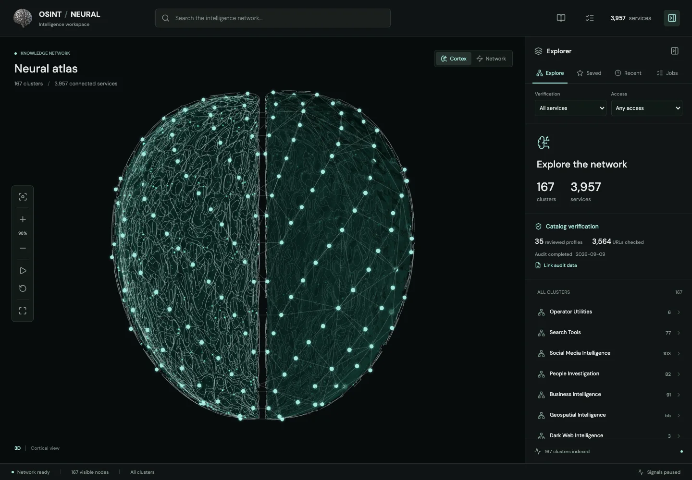

# OSINT / Neural

**A visual atlas for finding research tools without confusing availability with verified capability.**

_Actual unauthenticated public interface, captured September 21, 2026. No research targets, job history or signed-in account data are included._

[Open the explorer](https://osint-neural-atlas.pages.dev/)

## Problem and approach

Large tool directories are difficult to navigate and often make availability sound like a successful investigation. This explorer organises 3,951 external entries and six utilities into 167 clusters, with search, saved services and a procedural neural map. Evidence distinguishes link availability, scoped sample tests and tools not functionally tested.

## Architecture

React, React Three Fiber and Three.js provide the visual workspace. A static Cloudflare Pages build serves the catalog and reference material. The separate local-only Node/SQLite runtime provides bounded jobs; it is not exposed by the hosted explorer. Local inputs and search history are not part of this public case study.

## Verification

On September 21, 2026, all 49 catalog, command, job, hosting and network-policy tests passed locally. Those checks do not establish that every external provider works. The private repository has validation CI and an existing main-branch Cloudflare Pages integration.

## Access and limitations

The explorer is public; source code remains private by the owner's choice. External providers have their own access rules and privacy policies. A reachable page is not an identity match or an investigation result. The neural shape is a navigation interface, not a medical model. No user accounts, provider credentials or investigation outputs are published here.
