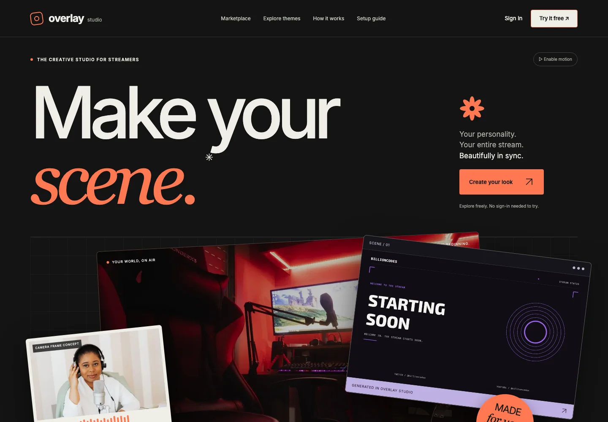

# Overlay Studio

**Turn a creator's identity into a coordinated streaming visual package.**

_Actual unauthenticated public landing-page capture, September 21, 2026. The artwork shown is an example, not proof of a purchased or delivered package._

[Explore the public preview](https://stream-overlay-builder.pages.dev/)

## Problem and approach

Streamers need scenes, frames, panels and transitions that work together rather than a folder of unrelated assets. A deterministic design engine combines theme, palette, typography and motion choices. The same renderer powers previews and exported artwork, reducing preview/export drift.

## Architecture

The TypeScript/Bun monorepo contains a Next.js creator experience, shared Canvas2D rendering, a bounded API, Redis-backed jobs and FFmpeg workers. Account-owned packages, private downloads and a persistent library are distinct from disposable queue history.

## Verification

On September 21, 232 tests passed locally; four render-integration cases were skipped by the ordinary unit-test command. The existing private CI includes unit, build, integration and smoke checks, plus a separately configured Cloudflare deployment job. This publication did not perform real payment, account or media-render transactions.

## Access and limitations

The public website is a preview. Hosted package generation requires the configured backend and access flow; a static website alone cannot render an OBS package. Paid checkout and verified payments are not enabled. Source, private libraries, credentials and render outputs remain private. Recipe variety does not guarantee perceptual uniqueness or commercial suitability.
