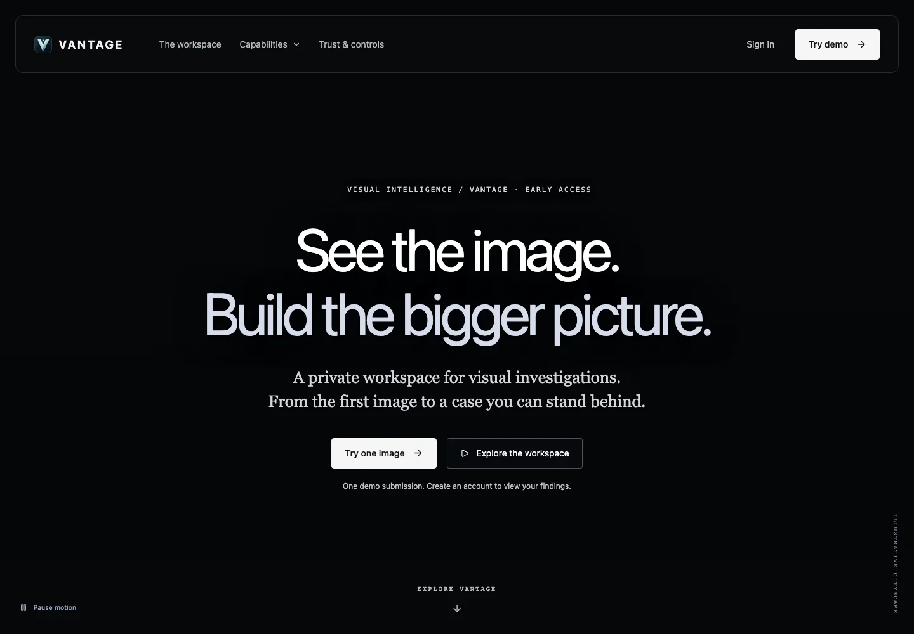

# Vantage Visual Intelligence

**Preserve the original image, inspect its evidence and keep human review attached to the case.**

_Actual unauthenticated landing-page capture, September 21, 2026. No customer evidence or private workspace is pictured._

[Visit the public pilot](https://vantageintel.app/)

## Problem and approach

Visual investigations need more than an unexplained model score. Vantage keeps source bytes and hashes, separates automated observations from reviewed conclusions, and retains case notes and export history. Accounts operate within tenant boundaries; uploaded evidence belongs in private storage rather than a portfolio gallery.

## Architecture

React and TypeScript power the interface. A Python/FastAPI service connects PostgreSQL with tenant isolation, S3-compatible evidence storage and Celery jobs. Firebase handles the configured account flow. The architecture includes source inspection, optional model hypotheses, manually reviewed map evidence and case exports.

## Verification

The September 21 publication review passed the web type check and production build plus 21 isolated authenticity and hosting-policy tests. A private GitHub Actions workflow repeats those checks without customer credentials. The service-backed integration suite, account creation and paid inference were deliberately not run for this publication; this is not a comprehensive security audit.

## Access and limitations

Source code, customer cases, account records and model credentials remain private. Model hypotheses are not proof of location, identity or authenticity. The product does not identify people through a face database. Deployment does not establish forensic accuracy or government accreditation. Production infrastructure rollout is separate from frontend CI.
